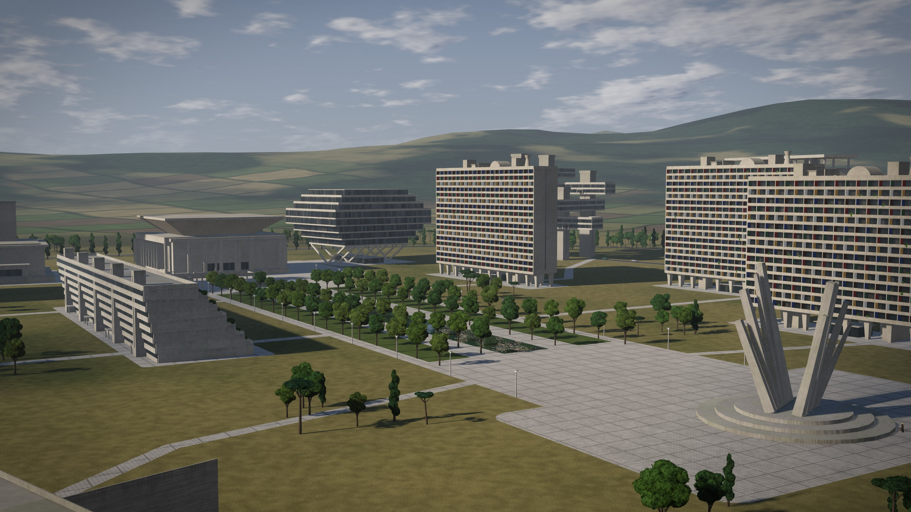
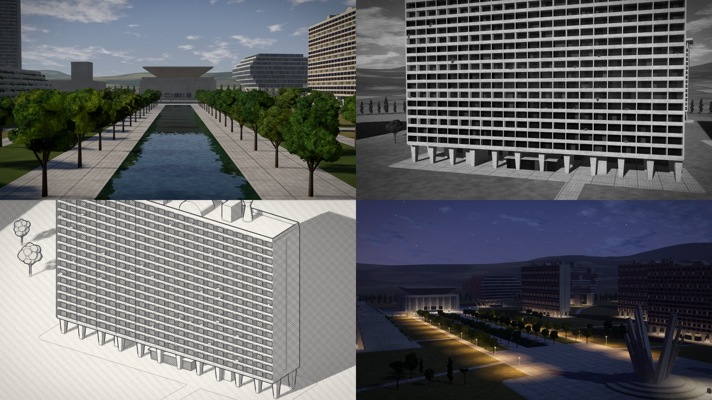

# BRUT

**Play it: https://brut-city.netlify.app**



A city builder in raw concrete. Twelve building types, each a parametric design you can pull about by
hand or tune from an inspector; a site to pave, flood and plant; studies of sun, wind, weather, daily
life and age; seven ways of drawing the result and six ways of standing in front of it.

It is a static site. There is no build step.

## Run it

```bash
node tools/serve.cjs 9333
```

Then open http://localhost:9333. Any static server pointed at `site/` works as well.

Useful query strings: `?fresh` discards the saved city and loads the demonstration estate, `?play`
skips the title, `?q=low|medium|high|ultra` forces a quality tier instead of timing the GPU.

## Deploy

`netlify.toml` publishes `site/`.

```bash
netlify deploy --prod --dir site --site <site-id>
```

## Layout

```
site/
  index.html, css/brut.css, fonts/        the page
  vendor/                                 three.js r180, unmodified
  js/main.js                              boot, loop, console harness (window.BRUT)
  js/gfx/                                 renderer: primitives, instanced batches, shaders, pipeline, sky, camera
  js/arch/                                the architecture: parameters, facade systems, generators
  js/world/                               ground and site plan, buildings, trees and lamps
  js/sim/                                 sun hours, wind, people and traffic, weather
  js/ui/                                  panels, input, drag handles, drawing furniture
  js/demo.js, js/estate.js                the demonstration city; estate layouts by doctrine
  js/actions.js, js/io.js, js/audio.js    editing and undo; files, links, photographs; sound
tools/
  serve.cjs                               static server, plus POST /__shot/<name> for screenshots
  smoke.mjs                               generates every type, preset and thousands of mutations headlessly
  imports.mjs                             checks every named import resolves
```

## How it draws

Every solid in the city is an instance of one of seven unit primitives, placed by a matrix and carrying
its own colour and material. A building is a few thousand of them, regenerated whenever a parameter
changes. The frame is deferred: two shadow cascades, an optional planar mirror for water, a G-buffer,
ambient occlusion, a composite with an analytic sky, and then progressive accumulation while the camera
is still, which is where the soft shadows and clean edges come from. The line lenses (ink, blueprint,
figure-ground) are drawn from the same G-buffer by finding edges in depth, normal and element id.



## Tests

```bash
node tools/smoke.mjs
node tools/imports.mjs
```

## Credits

- [three.js](https://threejs.org) r180, MIT licence, in `site/vendor/`.
- [Archivo](https://github.com/Omnibus-Type/Archivo) and [IBM Plex Mono](https://github.com/IBM/plex), both under the SIL Open Font License 1.1, in `site/fonts/`.

The sounds are synthesised in the browser and the textures are computed in the shaders; there are no other assets.

## Licence

MIT; see [LICENSE](LICENSE). The library and typefaces listed above keep their own licences.
